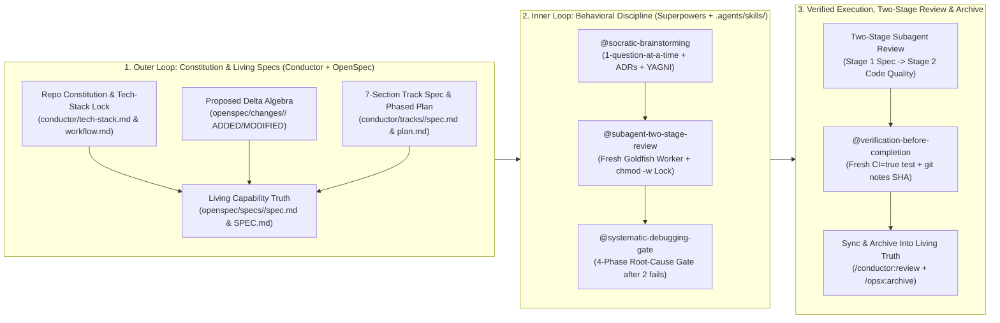

# SDD-Crash-Course: The Hands-On Playground for Context-Driven & Spec-Driven Development

> **Author:** **Alejandro Kaspar - AI Forward Deployed Engineer**  
> **100% Hands-On, Beginner-Friendly Self-Diagnosing Playground (`TaskFlow` Unified App)**  
> **Core Stack:** **Outer Loop:** [Conductor](https://github.com/gemini-cli-extensions/conductor) + [OpenSpec (`@fission-ai/openspec`)](https://github.com/Fission-AI/OpenSpec) + `SPEC.md` (SSOT) $\times$ **Inner Loop:** [Claude Superpowers (`obra/superpowers`)](https://github.com/obra/superpowers) Behavioral Skills (`.agents/skills/`)  
> **License:** Code under **Apache 2.0** (with mandatory [`NOTICE`](./NOTICE) attribution) · Coursebook, Slides, Videos & Walkthroughs under **[CC BY 4.0](https://creativecommons.org/licenses/by/4.0/)** (*Attribution Required — must credit **Alejandro Kaspar - AI Forward Deployed Engineer***)  

---

## 1. Welcome to `SDD-Crash-Course`

**`SDD-Crash-Course`** is a self-contained, hands-on playground for learning and teaching **Specificational Coding / Spec-Driven Development (SDD)** and **Context-Driven Development (CDD)** using **Conductor** and **OpenSpec** together.

Instead of complicated distributed-systems math, you build and evolve **one simple, everyday application across all 6 labs**: **`TaskFlow` (a Personal To-Do, Habit & Kanban Productivity Workspace)**. Each lab focuses on **4 crystal-clear requirements (`REQ-0001..REQ-0004`)** in ~50 lines of plain Python so you can read any lab in **2 minutes** and focus 100% on the SDD workflow:
1. **`WALKTHROUGH.md`**: Step-by-step instructions showing **Interactive Socratic Grilling ("The Grill")**, **Conductor Slash Commands** (`/conductor:setup`, `/conductor:newTrack`, `/conductor:implement`, `/conductor:review`, `/conductor:revert`), and **OpenSpec Commands** (`/opsx:explore`, `/opsx:propose`, `/opsx:apply`, `/opsx:verify`, `/opsx:archive`).
2. **Simple, Everyday Python Modules (`~50 lines` each)**: Zero external cloud accounts, zero third-party packages, and zero complex math—runs 100% locally in `< 0.5 seconds`.
3. **`expected_output/`**: Reference specifications (`spec.md`, `design.md`, `ADR-*.md`, `plan.md`, `tasks.md`), clean Python implementations, and 4 unit tests per lab (`test_req0001_...` through `test_req0004_...`).
4. **`./self_diagnose.sh`**: Deterministic verification script in every lab folder (and `./self_diagnose_all.sh` at the root running all 6 labs and 24 unit tests).

---

## 2. Quick Navigation: The 6 Progressive `TaskFlow` Labs (`REQ-0001..REQ-0004` Each)

| Lab | SDD Stage & Core Action | `TaskFlow` Module | What You Do (in 5 Minutes) | Self-Diagnosis Script |
| :--- | :--- | :--- | :--- | :--- |
| **`01`** | **Greenfield Proposal $\to$ Specs** (*Socratic Grilling + Propose*) | **Core To-Do List** (`todo_list.py`) | Turn a 1-paragraph product note (`proposal.md`) into 3 Socratic Q&A answers, `openspec/specs/todo-list/spec.md` (`REQ-0001..0004`), 2 ADRs, and a 7-section Conductor Track Spec. | `./labs/lab_01_greenfield_proposals_to_specs/self_diagnose.sh` |
| **`02`** | **Brownfield Spec Recovery** (*Spec-Driven Testing + Sync Spec*) | **Tag & Priority Organizer** (`task_organizer.py`) | Reverse-engineer an undocumented 50-line module into `openspec/specs/task-organizer/spec.md` (`REQ-0001..0004`) and `ADR-0001-tag-normalization.md` without modifying code. | `./labs/lab_02_brownfield_spec_recovery/self_diagnose.sh` |
| **`03`** | **From Specs to TDD Code** (*Act on Spec / Apply*) | **Daily Habit Streak Tracker** (`habit_tracker.py`) | Turn an approved Duolingo-style streak spec (`REQ-0001..0004`: add habit, consecutive day `+1`, same-day idempotent, skipped-day reset) into 4 Red-Green-Refactor TDD tests & code. | `./labs/lab_03_from_specs_to_tdd_code/self_diagnose.sh` |
| **`04`** | **Spec Drift & 5-Step Refactoring** (*Semantic Diffing + Surgical Fix*) | **Daily Time-Budget Planner** (`daily_planner.py`) | Catch a 1-character off-by-one bug (`>=` instead of `>`) in `schedule_task()` that falsely rejects a task using the exact remaining minutes (`REQ-0003`), while locking `F-02..F-04` in `Out of Scope`. | `./labs/lab_04_drift_detection_and_5step_refactoring/self_diagnose.sh` |
| **`05`** | **SDD Code Review & Stacked PRs** (*Verify + Sync + Clean/Archive*) | **Quick Notes Board** (`notes_board.py`) | Review `subpar_change.patch` adding `pin_note`, catch 3 SDD violations (reversed `list_notes()` breaking `REQ-0002`, missing `REQ-0004` spec, missing `KeyError`), and batch `tasks.md` into Stacked PRs. | `./labs/lab_05_sdd_code_review_and_stacked_prs/self_diagnose.sh` |
| **`06`** | **Capstone: `SPEC.md` (SSOT) & Clean-Room Rebuild Test** (*Code as Compiled Artifact*) | **Unified Kanban Board** (`taskflow_app.py`) | Rebuild `TaskFlowBoard` (`todo` $\to$ `in_progress` $\to$ `done` with WIP limit & story points) in `/tmp` from `SPEC.md` alone and pass read-only (`chmod -w`) `adversarial_tests/`. | `./labs/lab_06_capstone_ssot_and_rebuild_test/self_diagnose.sh` |

### Engineering Playbooks, Interactive Visual Companions, Dual-Book PDF Manuals & 36-Slide Deck
- **[Interactive Widescreen HTML5 Slide Deck (`slides/interactive_slides.html`)](./slides/interactive_slides.html)**: Complete 36-slide widescreen (`16:9`) browser presentation deck featuring inline vector SVG diagrams, rich hoverover tooltips, clickable `①`–`④` *Learn About* hotspot pins, live interactive simulators for all 6 `TaskFlow` labs, a *Common Misconception* (`✕` vs. `✓`) & *Stop & Think* drawer, synced Speaker Notes drawer, and `contenteditable` Live Inline Edit Mode.
- **[Interactive Visual Study Companion (`docs/interactive_visual_guide.html`)](./docs/interactive_visual_guide.html)**: Self-contained *Learn About* HTML5 companion featuring an **Everyday Metaphor vs. Under-the-Hood** toggle, clickable `①`–`⑤` architecture hotspot pins, interactive `TaskFlow` Lab 01–06 walkthroughs & boundary simulator, *Common Misconception* (`✕` vs. `✓`) cards, and a causal mastery check with a 3-rung graduated hint ladder.
- **[Dual-Engine Engineering Playbook (`playbooks/DUAL_ENGINE_CONDUCTOR_OPENSPEC_PLAYBOOK.md`)](./playbooks/DUAL_ENGINE_CONDUCTOR_OPENSPEC_PLAYBOOK.md)**: Complete reference covering **Specificational Coding vs. Conversational Coding**, the **User–Spec–Agent / Spec–Code–Tests Triangle** (`Apply`, `Sync`, `Clean`), OpenSpec's **Semantic Diffing + Socratic Grilling ("The Grill")**, Karpathy's 4 Coding Agent Rules, and Joel Spolsky's **Law of Leaky Abstractions** mapped across all 6 `TaskFlow` labs.
- **[Student Textbook & Practical Field Guide PDF (`Coursebook_SDD_Conductor_OpenSpec.pdf`)](./Coursebook_SDD_Conductor_OpenSpec.pdf)**: Concise visual reference manual with final-print-size TikZ architecture blueprints, numbered *Learn About* hotspot pins (`①`–`④`), *Common Misconception* (`✕` vs. `✓`) and *Stop & Think* callouts, command tables, and copy-pasteable templates.
- **[Lecturer & Professor Instructor Manual PDF (`Lecturer_Manual_SDD_Conductor_OpenSpec.pdf`)](./Lecturer_Manual_SDD_Conductor_OpenSpec.pdf)**: Companion faculty and workshop instructor guide featuring 3 turnkey syllabi (8-Week University Seminar, 2-Day Bootcamp, 4-Session Workshop), slide-by-slide teaching playbooks for Slides 01–36, 6 live projector terminal demos, Socratic discussion prompts, 3-Rung Hint Ladders, complete Lab 01–06 answer keys, and a 100-point capstone rubric.
- **[36-Slide Widescreen `16:9` Presentation Deck (`slides/SDD_Crash_Course_Slides.pdf`)](./slides/SDD_Crash_Course_Slides.pdf), [Speaker Notes (`slides/SPEAKER_NOTES.md`)](./slides/SPEAKER_NOTES.md) & [Master Full-Course `1080p` Lecture Video (`slides/SDD_Crash_Course_Lecture.mp4`)](./slides/SDD_Crash_Course_Lecture.mp4)**: Complete step-by-step lecture deck (backed by 100% native editable vector shapes in Google Slides) and narrated `1080p` video series walking through Foundations and all 6 `TaskFlow` labs end-to-end.

### Step-by-Step End-to-End Video Curriculum (7 Narrated `1080p` Modules + Full Course Video)

| Module | Video File (`1080p` MP4) | Slides | What You Walk Through Step-by-Step |
| :--- | :--- | :--- | :--- |
| **Full Course (Master)** | [`slides/SDD_Crash_Course_Lecture.mp4`](./slides/SDD_Crash_Course_Lecture.mp4) | **Slides 01–36** | **Complete End-to-End Course Video** combining all 7 modules (Foundations + `TaskFlow` Labs 01–06 step-by-step). |
| **Module 01: Foundations & Dual-Engine** | [`slides/modules/Module_01_Foundations_and_Dual_Engine.mp4`](./slides/modules/Module_01_Foundations_and_Dual_Engine.mp4) | **Slides 01–06** | Specificational Coding vs. Conversational Coding & Ephemeral Plan Mode, the User–Spec–Agent Triangle (`Apply`, `Sync`, `Clean`), OpenSpec Socratic Grilling ("The Grill"), Conductor Engine, and `@writing-arch-specs` wiring. |
| **Module 02: Lab 01 Step-by-Step** | [`slides/modules/Module_02_Lab01_Greenfield_Todo_List.mp4`](./slides/modules/Module_02_Lab01_Greenfield_Todo_List.mp4) | **Slides 07–11** | **Lab 01 (`TodoList`)**: Socratic Grilling on `proposal.md` (`Q1..Q3`), authoring `openspec/specs/todo-list/spec.md` (`REQ-0001..0004`), `ADR-0001` & `ADR-0002`, 7-section Conductor `spec.md`, `todo_list.py`, and `./self_diagnose.sh`. |
| **Module 03: Lab 02 Step-by-Step** | [`slides/modules/Module_03_Lab02_Brownfield_Task_Organizer.mp4`](./slides/modules/Module_03_Lab02_Brownfield_Task_Organizer.mp4) | **Slides 12–16** | **Lab 02 (`TaskOrganizer`)**: Inspecting brownfield `service/task_organizer.py`, recovering `REQ-0001..0004` (`Sync Spec`), recording `ADR-0001-tag-normalization.md`, and running `./self_diagnose.sh`. |
| **Module 04: Lab 03 Step-by-Step** | [`slides/modules/Module_04_Lab03_TDD_Habit_Tracker.mp4`](./slides/modules/Module_04_Lab03_TDD_Habit_Tracker.mp4) | **Slides 17–21** | **Lab 03 (`HabitTracker`)**: Actuating `specs/spec.md` (`Act on Spec` / `Apply`) for daily habit streaks (`REQ-0001..0004`), writing `test_req0001..0004` in `test_habit_tracker.py`, implementing `habit_tracker.py`, and running `./self_diagnose.sh`. |
| **Module 05: Lab 04 Step-by-Step** | [`slides/modules/Module_05_Lab04_Drift_and_Scorecard_Refactoring.mp4`](./slides/modules/Module_05_Lab04_Drift_and_Scorecard_Refactoring.mp4) | **Slides 22–26** | **Lab 04 (`DailyPlanner`)**: Catching the `REQ-0003` off-by-one `>=` bug in `service/daily_planner.py`, triaging `scorecard.md` (`F-01` vs. `F-02..F-04` locked in `Out of Scope`), fixing `>=` $\to$ `>`, and running `./self_diagnose.sh`. |
| **Module 06: Lab 05 Step-by-Step** | [`slides/modules/Module_06_Lab05_SDD_Code_Review_and_Stacked_PRs.mp4`](./slides/modules/Module_06_Lab05_SDD_Code_Review_and_Stacked_PRs.mp4) | **Slides 27–31** | **Lab 05 (`NotesBoard`)**: Reviewing `subpar_change.patch`, catching all 3 SDD violations (reversed `list_notes()`, un-specced `pin_note`, missing `KeyError`), syncing `REQ-0004`, batching `tasks.md` (`Archive PR N+1`), and running `./self_diagnose.sh`. |
| **Module 07: Lab 06 Capstone Step-by-Step** | [`slides/modules/Module_07_Lab06_Capstone_SSOT_and_Rebuild_Test.mp4`](./slides/modules/Module_07_Lab06_Capstone_SSOT_and_Rebuild_Test.mp4) | **Slides 32–36** | **Lab 06 (`TaskFlowBoard`) & Graduation**: Inspecting the 8-section `SPEC.md` (`REQ-0001..0004`), rebuilding `taskflow_app.py` in `/tmp` against read-only (`chmod -w`) `adversarial_tests/`, and running `./self_diagnose_all.sh` (`24/24` tests passing). |

---

## 3. Unified Architecture: Outer-Loop (`Conductor` + `OpenSpec` + `SPEC.md`) $\times$ Inner-Loop (`Superpowers` Behavioral Skills)

Why combine **Conductor + OpenSpec + `SPEC.md`** with **Claude Superpowers (`obra/superpowers`)**?
- **Superpowers alone** gives you disciplined inner-loop agent habits (`brainstorming`, `writing-plans`, `subagent-driven-development`, `systematic-debugging`, `verification-before-completion`), but stores specs as chronological date-stamped snapshots (`docs/superpowers/specs/YYYY-MM-DD-*.md`) that quickly rot into a historical graveyard.
- **Our Unified Stack** keeps all of Superpowers' inner-loop behavioral discipline (in [`.agents/skills/`](./.agents/skills/)) while routing every specification, delta, and TDD task into the living **Two-Plane OpenSpec (`openspec/specs/`) + Conductor (`conductor/tracks/`) + `SPEC.md` SSOT** outer loop:



### The 5 Built-In `.agents/skills/` (Outer-Loop SDD $\times$ Inner-Loop Superpowers)
1. **[`@writing-arch-specs`](./.agents/skills/writing-arch-specs/SKILL.md)**: Enforces the 7-Section Track Specification Anatomy and OpenSpec RFC 2119 + 4-hashtag `#### Scenario:` contract rules.
2. **[`@socratic-brainstorming`](./.agents/skills/socratic-brainstorming/SKILL.md)**: Enforces 1-question-at-a-time Socratic grilling, 2–3 `ADR-XXXX` trade-off proposals, 200–300 word incremental validation, and YAGNI—routing directly into `openspec/changes/` and `conductor/tracks/` instead of dead `YYYY-MM-DD-*-design.md` files.
3. **[`@subagent-two-stage-review`](./.agents/skills/subagent-two-stage-review/SKILL.md)**: Dispatches a fresh stateless ("Goldfish") worker per task (`Audit -> RED -> GREEN -> Verify`) with a read-only (`chmod -w`) test lock, gated by **Stage 1 (`Spec Compliance Review`)** before **Stage 2 (`Code Quality & Constitution Review`)**.
4. **[`@systematic-debugging-gate`](./.agents/skills/systematic-debugging-gate/SKILL.md)**: Triggers automatically after 2 test failures or during Spec Drift triage (`Lab 04`), enforcing a 4-phase root-cause protocol (Spec-to-Code Semantic Diff $\to$ Fixture Trace $\to$ Minimal Reproduction Test $\to$ Surgical Fix).
5. **[`@verification-before-completion`](./.agents/skills/verification-before-completion/SKILL.md)**: Enforces the iron law that no task is marked `[x]`, checkpointed, or archived without fresh, in-turn execution of `CI=true python3 -m unittest` and `./self_diagnose.sh`.

---

## 4. 2-Minute Quickstart & Running Self-Diagnosis

```bash
# 1. Install Gemini CLI Conductor & OpenSpec CLI (Optional for live agent runs)
gemini extensions install https://github.com/gemini-cli-extensions/conductor --auto-update
npm install -g @fission-ai/openspec@latest

# 2. Run the master self-diagnosis harness across all 6 hands-on TaskFlow labs!
./self_diagnose_all.sh

# 3. Or run self-diagnosis on an individual lab as you work through it:
./labs/lab_03_from_specs_to_tdd_code/self_diagnose.sh
```

---

## 5. External Hands-On Codelabs & Video Tutorials

To supplement the 6 local `TaskFlow` labs in this repository, explore these public hands-on resources:
1. **[Google Codelab: Plan and Build Apps with Gemini CLI Conductor (69 min)](https://codelabs.developers.google.com/next26/advanced-planning)** — Build a greenfield web app from scratch, then iterate on it as a brownfield app adding Firebase Auth & Storage.
2. **[Multi-Agent Conductor Plugin Codelab](https://codelabs.developers.google.com/conductor-plugin)** — Using Conductor across Gemini CLI, Antigravity CLI, and Claude Code.
3. **[Google Developers Blog: Introducing Context-Driven Development for Gemini CLI](https://developers.googleblog.com/conductor-introducing-context-driven-development-for-gemini-cli/)**
4. **[OpenSpec Official Docs & Interactive `/opsx:onboard` Tutorial](https://openspec.dev/)** ([GitHub: `Fission-AI/OpenSpec`](https://github.com/Fission-AI/OpenSpec))
5. **[Video Tutorial: OpenSpec Full Step-by-Step Walkthrough](https://www.youtube.com/watch?v=xwpmPP4mNBQ)** & **DeepLearning.AI Course: *"Spec-Driven Development with Coding Agents"***.

---

## 6. License & Mandatory Attribution (`CC BY 4.0` + Apache 2.0 `NOTICE`)

**Author:** **Alejandro Kaspar - AI Forward Deployed Engineer**

This repository is open-access and dual-licensed so you can freely use, adapt, or teach with it in university courses, workshops, or engineering teams **as long as you attribute the author**:

1. **Course Materials (Coursebook PDF, Presentation Slides, Lecture Videos, Playbooks & Walkthroughs)**:  
   Licensed under **[Creative Commons Attribution 4.0 International (`CC BY 4.0`)](https://creativecommons.org/licenses/by/4.0/)**. You are free to share and adapt the materials for any purpose, provided you give visible credit to **"Alejandro Kaspar - AI Forward Deployed Engineer"** and link back to [`https://github.com/adkaspar-google/sdd-course`](https://github.com/adkaspar-google/sdd-course).
2. **Source Code & Executable Scripts (`.py`, `.sh`, `.yaml`)**:  
   Licensed under the **[Apache License, Version 2.0](./LICENSE)** with a mandatory **[`NOTICE`](./NOTICE)** file. Under Section 4(d) of the Apache 2.0 License, any redistribution or derivative work must retain the attribution notices in [`NOTICE`](./NOTICE).

### How to Cite / Credit This Course

**Plain-Text Attribution (for slides, syllabi, or adapted repos):**
> Adapted from *SDD-Crash-Course: The Hands-On Playground for Context-Driven & Spec-Driven Development* by **Alejandro Kaspar - AI Forward Deployed Engineer** (`https://github.com/adkaspar-google/sdd-course`), licensed under CC BY 4.0 / Apache 2.0.

**BibTeX Citation (also available via GitHub's *"Cite this repository"* button from [`CITATION.cff`](./CITATION.cff)):**
```bibtex
@misc{kaspar2026sddcrashcourse,
  author       = {Kaspar, Alejandro},
  title        = {{SDD-Crash-Course: The Hands-On Playground for Context-Driven \& Spec-Driven Development}},
  year         = {2026},
  note         = {AI Forward Deployed Engineer},
  howpublished = {\url{https://github.com/adkaspar-google/sdd-course}}
}
```
