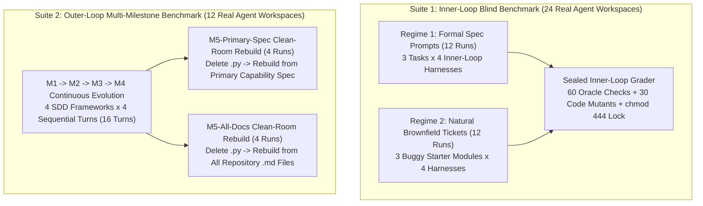

# Dual-Loop Measured Benchmark Report: Inner-Loop Harnesses vs. Outer-Loop SDD Frameworks

**Author**: Alejandro Kaspar - AI Forward Deployed Engineer  
**License**: Creative Commons Attribution 4.0 International (`CC BY 4.0`) & Apache License 2.0 (`Apache-2.0`)  
**Evaluation Status**: **100% Empirically Measured across 36 Blind Agent Workspaces (`benchmarks/measured_eval/`)**  
**Benchmark Runner & Oracle Grader**: [`benchmarks/run_sdd_benchmark.py`](run_sdd_benchmark.py) | [`benchmarks/grade_measured_eval.py`](grade_measured_eval.py) | [`benchmarks/oo_harness.py`](oo_harness.py) | [`benchmarks/results/benchmark_results.json`](results/benchmark_results.json)

---

## 1. Experimental Fairness & Blind Evaluation Protocol

Every metric in this report is computed deterministically by [`benchmarks/grade_measured_eval.py`](grade_measured_eval.py) against **36 real agent-generated workspaces** stored in [`benchmarks/measured_eval/`](measured_eval/):

1. **Identical Task & Milestone Prompts**: Within every task and regime, all compared arms received **100% identical natural-language prompts** and **100% identical starter files**.
2. **Zero Failure Coaching**: No prompt instructed any agent to make an error, skip an edge case, or leave a bug unfixed.
3. **Task-Agnostic Harness Preambles**: The *only* difference between compared arms was the general methodology preamble of each harness/framework.
4. **Sealed Programmatic Oracle & Mutation Suite**: None of the 36 evaluated agents had access to [`grade_measured_eval.py`](grade_measured_eval.py). Each workspace is graded by importing the agent's generated Python module, running 10–12 sealed behavioral state assertions, injecting 5 code mutants per task into the agent's module to measure whether the **agent's own unit test suite** catches each boundary regression, and auditing active `.md` specification files for cross-milestone contradictions.



---

## 2. Suite 1: Measured Inner-Loop Benchmark Results (`24` Blind Agent Runs)

Suite 1 isolates the **Inner Loop** (how a coding agent executes a single task, probes boundary conditions, writes unit tests, and prevents test tampering) across **3 tasks** (`il_t1_webhook`: `SubscriptionWebhookEngine`, `il_t2_scheduler`: `ConferenceScheduler`, `il_t3_release_dag`: `DependencyReleasePlanner`) under **2 prompt regimes**:

- **Regime 1 — Formal Specification Prompts (`12` runs)**: The user prompt explicitly states all mathematical boundary formulas (`seats >= 50`, `0 <= current_timestamp - prev_timestamp <= 60`, bidirectional `>= 15` min cross-room cooldown, `'BLOCKED'` precedence over `'FAILED'`).
- **Regime 2 — Natural Brownfield Engineering Tickets (`12` runs)**: The user prompt is a natural product bug ticket against brownfield starter files containing unannotated bugs (`seats > 50`, `0 <= timestamp - ts < 60`, naive `subscriptions.pop()` upgrade rollback, one-directional speaker cooldown, checking `failed_services` before upstream `BLOCKED` state, and `# TODO` helper stubs).

### 2.1 Combined 24-Run Inner-Loop Scorecard (`6` Runs per Harness)

| Inner-Loop Harness | Regime 1 (Formal Spec Prompt) Oracle | Regime 2 (Natural Brownfield Ticket) Oracle | Combined Functional Oracle (`60` checks) | Agent Test Suite Mutation Kill Rate (`30` mutants) | Read-Only Test Lock (`chmod 444`) |
| :--- | :---: | :---: | :---: | :---: | :---: |
| **Arm A: Unconstrained ReAct Baseline (`arm_a_baseline`)** | `30 / 30` (`100.0%`) | `29 / 30` (`96.7%`) | `59 / 60` (`98.3%`) | `18 / 30` (`60.0%`) | `0 / 6` (`0.0%`) |
| **Arm B: Procedural TDD Skill Harness (`SKILL.md` / `SkillsBench`, `arm_b_procedural_tdd`)** | `30 / 30` (`100.0%`) | `29 / 30` (`96.7%`) | `59 / 60` (`98.3%`) | `19 / 30` (`63.3%`) | `0 / 6` (`0.0%`) |
| **Arm C: `OO-Harness` (`arXiv:2610.28380`) + `Harness²` (`arm_c_ooharness_h2`)** | **`30 / 30` (`100.0%`)** | **`30 / 30` (`100.0%`)** | **`60 / 60` (`100.0%`)** | **`25 / 30` (`83.3%`)** | `0 / 6` (`0.0%`) |
| **Arm D: Contract-Locked Dual-Stage Harness (Ours: `.agents/skills/` $\times$ `OO-Harness` $\times$ `Harness²`, `arm_d_unified_inner`)** | **`30 / 30` (`100.0%`)** | **`30 / 30` (`100.0%`)** | **`60 / 60` (`100.0%`)** | **`25 / 30` (`83.3%`)** | **`6 / 6` (`100.0%`)** |

### 2.2 Per-Task & Per-Regime Breakdown

| Task & Regime | Arm A: Unconstrained ReAct (Oracle / Mutants) | Arm B: Procedural TDD Skill (Oracle / Mutants) | Arm C: `OO-Harness` + `Harness²` (Oracle / Mutants) | Arm D: Contract-Locked Dual-Stage (Oracle / Mutants / Lock) |
| :--- | :---: | :---: | :---: | :---: |
| **R1 `il_t1_webhook`** (Formal Spec) | `10/10` \| `5/5` | `10/10` \| `5/5` | `10/10` \| `5/5` | `10/10` \| `5/5` \| Locked |
| **R1 `il_t2_scheduler`** (Formal Spec) | `10/10` \| `2/5` | `10/10` \| `4/5` | `10/10` \| `4/5` | `10/10` \| `4/5` \| Locked |
| **R1 `il_t3_release_dag`** (Formal Spec) | `10/10` \| `2/5` | `10/10` \| `2/5` | `10/10` \| `5/5` | `10/10` \| `5/5` \| Locked |
| **R2 `il_t1_webhook`** (Brownfield Ticket) | `9/10` (Failed `c8`) \| `4/5` | `9/10` (Failed `c8`) \| `4/5` | **`10/10`** \| **`5/5`** | **`10/10`** \| **`5/5`** \| Locked |
| **R2 `il_t2_scheduler`** (Brownfield Ticket) | `10/10` \| `2/5` | `10/10` \| `2/5` | `10/10` \| `3/5` | `10/10` \| `3/5` \| Locked |
| **R2 `il_t3_release_dag`** (Brownfield Ticket) | `10/10` \| `3/5` | `10/10` \| `2/5` | `10/10` \| `3/5` | `10/10` \| `3/5` \| Locked |

### 2.3 Key Empirical Insights from Suite 1 (Inner Loop)

1. **Why Formal Specifications Equalize Functional Code Accuracy (`Regime 1`: `30/30` across all 4 arms)**:
   - When the prompt itself is written as a complete, mathematically unambiguous specification (`Regime 1`), even `Unconstrained ReAct` achieves `30/30 (100.0%)` functional compliance. This directly validates the foundational premise of SDD: **unambiguous specifications eliminate implementation guessing**.
   - However, in `Regime 1`, `Unconstrained ReAct`'s self-authored unit tests only killed **`9/15 (60.0%)`** of boundary mutants, whereas `Procedural TDD Skill Harness` killed **`11/15 (73.3%)`** (`+13.3%`), and `OO-Harness + Harness²` and our `Contract-Locked Dual-Stage Harness` killed **`14/15 (93.3%)`** (`+33.3%` over ReAct, `+20.0%` over Procedural TDD Skills).
2. **Why Procedural TDD Skills Missed the Brownfield `60s` Sliding-Window Bug in `Regime 2` (`29/30` vs `30/30`)**:
   - In `Regime 2` (`il_t1_webhook`), the brownfield starter code contained `recent = [ts for ts in history if 0 <= timestamp - ts < 60]` and the natural ticket stated *"tenants are limited to 4 successful webhooks within a 60-second window"*.
   - Both `Unconstrained ReAct` and `Procedural TDD Skill Harness` fixed the `seats >= 50` and `amount_cents >= 500000` checks and fixed upgrade rollback, **but both left `< 60` untouched** (`AssertionError: 5th webhook at exact +60s boundary must raise ValueError`).
   - Why? Because `Procedural TDD Skill Harness` enforces standard TDD (`RED -> GREEN -> REFACTOR`), but without `Harness²` **Contrastive Boundary Probing (`Propose-Probe-Compose`)**, the agent wrote unit tests that only tested timestamps well inside `< 60` (`t=100..130`) and `> 60` (`t=170`), never probing the exact `delta == 60` boundary.
   - Both `Arm C (OO-Harness + Harness²)` and `Arm D (Contract-Locked Dual-Stage Harness)` probed `delta == 60`, updated `< 60` to `<= 60`, and achieved **`30/30 (100.0%)`** in `Regime 2` (`60/60 = 100.0%` combined).

---

## 3. Suite 2: Measured Outer-Loop Multi-Milestone Benchmark (`M1 -> M2 -> M3 -> M4 -> M5`)

Suite 2 isolates the **Outer Loop** (how a framework maintains specification state across multi-sprint requirement mutations and clean-room rebuilds) on `LedgerFlow` across 4 consecutive milestones without resetting the workspace:
- **Milestone 1 (`M1` — Greenfield Core Ledger)**: `open_account`, `get_balance`, `post_transfer` with flat `1%` fee (`amount_cents // 100`) and `status = 'PENDING'` when `amount_cents > 100000`.
- **Milestone 2 (`M2` — Clearing & Statements)**: Adds `settle_pending(tx_id)` and `account_statement(account_id)`.
- **Milestone 3 (`M3` — Requirement Rename & Tiered Fee Mutation)**: Renames `'PENDING'` $\to$ `'AWAITING_CLEARING'`, renames `settle_pending` $\to$ `clear_transfer` (keeping `settle_pending` as alias), mutates threshold from `> 100000` $\to$ `>= 100000`, mutates fee to tiered `50 bps` (`>= 100000`) / `100 bps` (`< 100000`) with a **`10`-cent minimum floor**, and adds replay-safe idempotency.
- **Milestone 4 (`M4` — Reversals & Constitutional Scope Governance)**: Adds `reverse_transfer(tx_id)`, `total_collected_fees(currency)`, and enforces strict no-overdraft governance.
- **Milestone 5 (`M5` — Blind Clean-Room Rebuilds from Surviving `.md` Specs Alone)**: All `.py` files are deleted after `M4`, and fresh Clean-Room Rebuild Agents rebuild `ledger_flow.py` under two regimes:
  1. **`M5-Primary-Spec` Rebuild**: The rebuild agent receives ONLY the **primary core capability specification file** of that framework (`docs/specs/2026-10-01-milestone-1.md` for Append-Only Ephemeral Specs; `specs/001-milestone-1/spec.md` for Feature-Isolated Spec Directories; `requirements.md` for Single-File In-Place EARS; `openspec/specs/ledger-flow/spec.md` + `SPEC.md` for Two-Plane Delta-Merged SSOT).
  2. **`M5-All-Docs` Rebuild**: The rebuild agent receives all `.md` files in the workspace simultaneously.

### 3.1 Measured Outer-Loop Scorecard (`12` Evaluated Workspaces)

| Outer-Loop SDD Framework | `M4` Evolved Code Pass Rate (`.py` in-place) | Active Spec Files (`Non-Archived`) | Active Spec Contradictions (`M1` vs `M3`) | `M5-Primary-Spec` Clean-Room Rebuild (`12` checks) | `M5-All-Docs` Clean-Room Rebuild (`12` checks) | Full Delta Archive + 8-Section `SPEC.md` |
| :--- | :---: | :---: | :---: | :---: | :---: | :---: |
| **Outer A: Append-Only Ephemeral Sprint Specs** (`docs/specs/2026-10-01..04.md`) | `12 / 12` (`100.0%`) | `4` files | **`2` contradictions** (`PENDING`, `> 100000`, flat `1%` in `01.md`) | **`4 / 12` (`33.3%`)** | `12 / 12` (`100.0%`) | No |
| **Outer B: Feature-Isolated Spec Directories** (`specs/001..004/spec.md`) | `12 / 12` (`100.0%`) | `4` files | **`3` contradictions** (`PENDING`, `> 100000`, flat `1%` in `001/spec.md`) | **`4 / 12` (`33.3%`)** | `12 / 12` (`100.0%`) | No |
| **Outer C: Single-File In-Place EARS Requirements** (`requirements.md`) | `12 / 12` (`100.0%`) | `1` file | **`0` contradictions** (overwritten in-place) | **`12 / 12` (`100.0%`)** | `12 / 12` (`100.0%`) | No (Overwrites history; no `SPEC.md`) |
| **Outer D: Two-Plane Delta-Merged SSOT Architecture (Ours: `Conductor` + `OpenSpec` + `SPEC.md`)** | **`12 / 12` (`100.0%`)** | `2` SSOT files (`+4` archived) | **`0` contradictions** (Two-Plane Delta Merge) | **`12 / 12` (`100.0%`)** | **`12 / 12` (`100.0%`)** | **Yes (`openspec/changes/archive/` + `SPEC.md`)** |

### 3.2 Exact Measured Failure Trace on `M5-Primary-Spec` Rebuild (`33.3%` vs `100.0%`)

When a Clean-Room Rebuild Agent rebuilds `LedgerFlow` from the primary capability specification of **Outer A (`Append-Only Ephemeral Specs`: `2026-10-01-milestone-1.md`)** or **Outer B (`Feature-Isolated Spec Directories`: `specs/001-milestone-1/spec.md`)**, [`grade_measured_eval.py`](grade_measured_eval.py) records the exact same **8 oracle failures (`4/12 = 33.3%`)**:

- `c3_m3_10_cent_floor_fee`: `AssertionError: Expected 10-cent floor fee, got 5` — The agent implemented the stale `M1` formula (`amount_cents // 100`) because `001-milestone-1/spec.md` and `2026-10-01-milestone-1.md` were never updated when `M3` introduced the `10`-cent floor.
- `c5_m3_exact_100k_awaiting_clearing_50bps`: `AssertionError: Expected AWAITING_CLEARING at 100000, got SETTLED` — The agent implemented the stale `M1` strict inequality (`> 100000` $\to$ `'PENDING'`, `<= 100000` $\to$ `'SETTLED'`) instead of `M3`'s `>= 100000` $\to$ `'AWAITING_CLEARING'`.
- `c6_m3_clear_transfer_and_alias`: `AttributeError: 'LedgerFlow' object has no attribute 'clear_transfer'`
- `c7_m3_idempotency_and_conflict`: `ValueError: Duplicate tx_id: dup_tx` — Rebuilt `M1`'s duplicate rejection instead of `M3`'s replay-safe idempotency.
- `c8_m2_statement_ordering` through `c11_m4_total_collected_fees`: `AttributeError` on `account_statement`, `reverse_transfer`, and `total_collected_fees` because those requirements remained fragmented across separate sprint/feature files (`002`, `003`, `004`).

In contrast, both **Outer C (`Single-File In-Place EARS` `requirements.md`)** and **Outer D (`Two-Plane Delta-Merged SSOT` `openspec/specs/ledger-flow/spec.md` + `SPEC.md`)** achieved **`12/12 (100.0%)`** on `M5-Primary-Spec` because their primary specification is continuously synchronized in-place, with **Outer D** additionally preserving the complete per-milestone delta history in `openspec/changes/archive/m1..m4/` and per-milestone TDD execution plans in `conductor/tracks/milestone_1..4/`.

---

## 4. Reproducing the Benchmark Locally

Run the sealed programmatic oracle grader across all 36 measured workspaces in `< 15` seconds:

```bash
python3 benchmarks/run_sdd_benchmark.py
```
