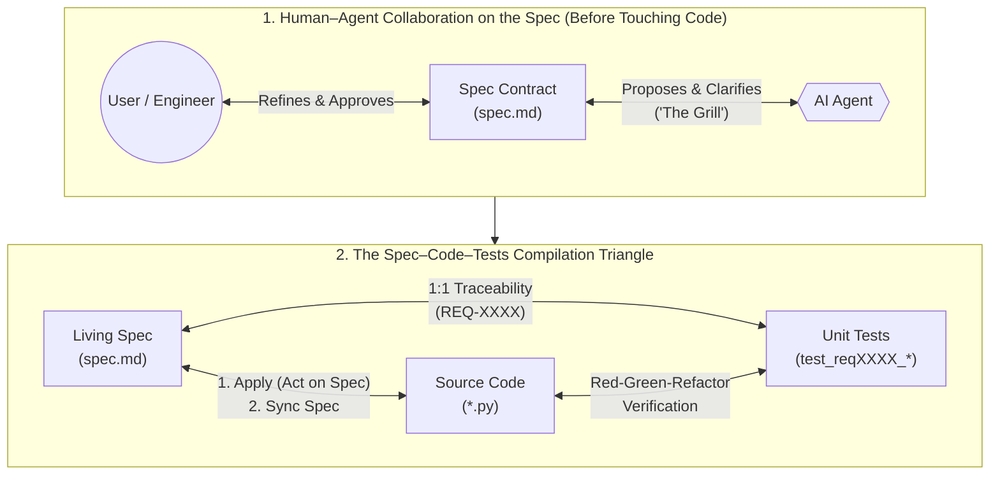
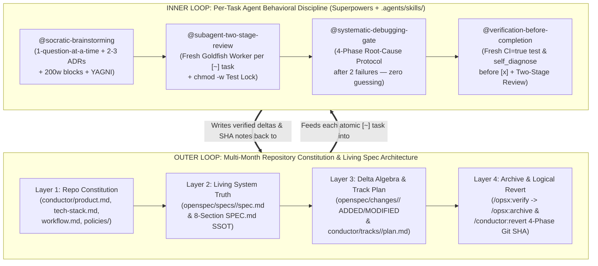

# Dual-Engine Engineering Playbook: Context-Driven & Spec-Driven Development with Conductor + OpenSpec

> **Purpose:** Complete practitioner playbook for combining **Conductor** (Context-Driven Development & Phased TDD Orchestration), **OpenSpec** (Capability Contracts & Delta Algebra), **Dedicated Spec Skills (`@writing-arch-specs`)**, and **`SPEC.md` (Single Source of Truth)** across the unified **`TaskFlow`** application.

---

## 1. Specificational Coding vs. Conversational Coding & The Spec Triangle

### A. What Is Specificational Coding (Spec Coding)?
- **Conversational Coding ("Vibe Coding")**: An engineer chats back-and-forth with an LLM to directly tweak source code. After a few turns, context rots and the agent silently breaks earlier requirements.
- **Ephemeral Planning Mode**: An agent generates a temporary step-by-step checklist for a single turn, which disappears as soon as the session ends.
- **Specificational Coding (Spec-Driven Development)**: An engineer collaborates with an LLM to refine a persistent **Specification (`spec.md`)** scoped to a module or service, and the LLM then synthesizes the **code** and **tests** from that contract. **The ultimate goal is to make source code a compiled artifact of the spec, just like machine code is a compiled artifact of source code today.**

### B. The User–Spec–Agent / Spec–Code–Tests Triangle & Three Core Actions


Once the human and agent agree on the specification, all work flows through **three core spec actions**:
1. **Apply (`Act on Spec` — Labs 01, 03, 06)**: Convert approved spec requirements and checked items into production code and `1:1` traceable unit tests (`/conductor:implement`, `/opsx:apply`).
2. **Sync (`Sync Spec` — Labs 02, 04, 05)**: Analyze existing brownfield code or proposed revisions and synchronize `spec.md` *without* mutating working code (`/opsx:explore`, `/opsx:sync`).
3. **Clean / Archive (`Clean Spec` — Lab 05)**: Remove transient change checklists and merge verified deltas into the permanent capability specification (`/opsx:archive`).

### C. How OpenSpec Analyzes Baseline Specs Against New Requirements
OpenSpec treats specifications as versioned contracts in Git (`openspec/specs/` for living truth, `openspec/changes/` for proposed deltas) using a 3-stage analysis mechanism:
1. **Semantic Diffing**: Loads the existing baseline spec (`openspec/specs/<capability>/spec.md`) and compares it against the incoming feature request or Statement of Work.
2. **Constraint Boundary Extraction**: Detects structural shifts (e.g., new validation boundaries, sorting rules, or Work-In-Progress limits).
3. **Interactive Socratic Prompting ("The Grill")**: If the prompt omits edge cases (e.g., *"What happens on blank titles?"* or *"Should an exact 100% budget match succeed or fail?"*), the agent blocks code generation and asks **3 crisp clarifying questions (`Q1`, `Q2`, `Q3`)** before emitting the `MODIFIED` and `ADDED` delta contract.

---

## 2. Living Guardrails: Wiring Dedicated Spec Skills & OpenSpec into Conductor

You **never** need to re-run `/conductor:setup` to add new rules or connect a custom spec-writing skill. Because Conductor re-reads `conductor/index.md` and `conductor/workflow.md` at the start of every `/conductor:newTrack`, `/conductor:implement`, and `/conductor:review` invocation, you simply edit two Markdown files in Git:

### 1. `conductor/workflow.md` (Track Specification Policy)
All track specifications (`conductor/tracks/<track_id>/spec.md`) MUST adhere to the single 7-Section Track Specification Anatomy defined in `.agents/skills/writing-arch-specs/SKILL.md`:
1. **Overview**
2. **Architecture & Component Topology**
3. **Functional Requirements**
4. **Non-Functional Requirements**
5. **Acceptance Criteria**
6. **Out of Scope**
7. **Verification Commands**

### 2. `conductor/index.md` (Capabilities & Inner-Loop Superpowers Handshake)
```markdown
## Outer-Loop Constitution & Inner-Loop Superpowers Skills
- [Writing Architecture Specs (`@writing-arch-specs`)](../.agents/skills/writing-arch-specs/SKILL.md)
- [Socratic Brainstorming (`@socratic-brainstorming`)](../.agents/skills/socratic-brainstorming/SKILL.md)
- [Subagent Two-Stage Review (`@subagent-two-stage-review`)](../.agents/skills/subagent-two-stage-review/SKILL.md)
- [4-Phase Debugging Gate (`@systematic-debugging-gate`)](../.agents/skills/systematic-debugging-gate/SKILL.md)
- [Verification Before Completion (`@verification-before-completion`)](../.agents/skills/verification-before-completion/SKILL.md)
- [OpenSpec Canonical Specifications](../openspec/specs/)
```

---

## 3. The 5-Step Brownfield Refactoring Workflow (Lab 04 Pattern)

```mermaid
sequenceDiagram
    autonumber
    actor Dev as Developer / Lead
    participant Scorecard as Audit Scorecard (scorecard.md)
    participant Cond as Conductor Engine
    participant SpecSkill as @writing-arch-specs + OpenSpec
    participant Codebase as Target Codebase (daily_planner.py)

    Note over Dev, Scorecard: Step 1 & 2: Assessment & Go/No-Go Decision
    Dev->>Scorecard: 1. Inspect Spec vs. Code Drift (F-01: REQ-0003 `>=` bug)
    Dev->>Scorecard: 2. Mark F-01 FIX NOW; Lock F-02..F-04 in Out of Scope

    Note over Dev, SpecSkill: Step 3: Dual-Engine Specification & Planning
    Dev->>Cond: 3a. Run /conductor:newTrack
    Cond->>SpecSkill: 3b. Draft 7-Section spec.md + TDD plan.md
    Dev->>Cond: Approve spec.md & plan.md

    Note over Cond, Codebase: Step 4: Phased TDD Implementation
    Dev->>Cond: 4. Run /conductor:implement
    Cond->>Codebase: Write Failing Test (Red) -> Fix `>=` to `>` (Green) -> Verify

    Note over Cond, Dev: Step 5: Multi-Axis Review & Archive
    Dev->>Cond: 5. Run /conductor:review + /opsx:verify -> /opsx:archive
```

---

## 4. Stacked Multi-PR Workflows (`git` / `jj`) & The Dedicated Archive PR `N+1` (Lab 05 Pattern)

When a feature is split across multiple Pull Requests:
1. **Keep 1 OpenSpec Change Folder (`1 Change = 1 Feature`):** Never create separate change folders per PR.
2. **Batch `tasks.md` by PR:** Group tasks under `## Batch 1 (PR 1)` and `## Batch 2 (PR 2)`.
3. **PR-Scoped Task Checkmarks:** In PR 1, mark **only** Batch 1 tasks `- [x]` after their tests pass in PR 1.
4. **Dedicated Archive PR `N+1`:** Once all code PRs merge, open a zero-code **Archive PR `N+1`** that runs `/opsx:archive <id>` to merge the delta into `openspec/specs/`.

---

## 5. The 5 Mandatory Security & Integrity Guardrails

1. **Mandatory Human-in-the-Loop (HITL) Plan Approval:** Never execute `/opsx:apply` or `/conductor:implement` without first reviewing and approving `spec.md` and `plan.md`/`tasks.md`.
2. **Indirect Prompt Injection Defense on `tasks.md`:** Treat workspace `tasks.md` and `proposal.md` files in shared repos as untrusted inputs.
3. **Strict Separation of Design and Implementation:** Never modify application source code during Proposal or Design phases (`/opsx:explore`, `/opsx:propose`, `/conductor:newTrack`).
4. **Truthful Same-PR Task Accounting:** Mark a task `- [x]` **only** after its implementation code and passing tests are verified in the current PR.
5. **VCS Move Provenance (`git mv`):** Preserve Git history when archiving changes into `openspec/changes/archive/`.

---

## 6. Human Interaction, Karpathy's 4 Rules & Joel Spolsky's Law of Leaky Abstractions

### A. The 4 Human Interaction Gates & Karpathy's 4 Coding Agent Rules

| Human Control Gate | How You Interact in `Conductor` + `OpenSpec` | Karpathy Agent Rule Enforced |
| :--- | :--- | :--- |
| **1. Interactive Socratic Grilling** (`/conductor:newTrack` & `/opsx:explore`) | Before writing code in **Lab 01**, the agent asks **3 targeted questions** (`Q1` blank titles, `Q2` sequential IDs, `Q3` missing IDs). | **1. Think Before Coding** (Zero silent assumptions) |
| **2. Spec-First Contract Approval** (`proposal.md`, `spec.md`, `ADR-*.md`) | You approve a crisp **4-requirement behavioral contract** (`REQ-0001..REQ-0004` in **Labs 01 & 02**) instead of reading a surprise code diff. | **2. Simplicity First** (Minimal surface area & explicit intent) |
| **3. Surgical Scope Lock** (`## 6. Out of Scope` & `scorecard.md`) | In **Lab 04**, you approve *only* `F-01` (fixing the `>=` bug in `daily_planner.py`) while locking `F-02..F-04` inside `## 6. Out of Scope`. | **3. Surgical Changes** (Zero scope creep on working code) |
| **4. Immutable Verifier & Short Leash** (`tasks.md` Batches & `chmod -w`) | Work is verified after each small batch (**Lab 03 & Lab 05**) and against read-only `adversarial_tests/` (**Lab 06**). | **4. Goal-Driven Execution** (Deterministic `./self_diagnose.sh` gate) |

### B. Joel Spolsky's Law of Leaky Abstractions Across the 6 `TaskFlow` Labs

In [***"The Law of Leaky Abstractions"*** (*Joel on Software*, Nov 11, 2002)](https://www.joelonsoftware.com/2002/11/11/the-law-of-leaky-abstractions/), Joel Spolsky wrote:
> *"Code generation tools which pretend to abstract out something, like all abstractions, leak, and the only way to deal with the leaks competently is to learn about how the abstractions work and what they are abstracting. **So the abstractions save us time working, but they don't save us time learning.**"*

Even in a simple everyday app like **`TaskFlow`**, a vague natural-language prompt leaks on edge cases unless pinned down by **`REQ-0001..REQ-0004`** and **`test_req0001..0004`**:

| Lab (`TaskFlow` Module) | Vague Conversational Prompt | How the Prompt Abstraction Leaks | How SDD + TDD Plugs the Leak |
| :--- | :--- | :--- | :--- |
| **`Lab 01` (`todo_list.py`)** | *"Build a to-do list."* | Blank titles `"   "` get saved; random UUIDs are hard to type; deleting a missing ID crashes. | Socratic Grilling (`Q1..Q3`) + `REQ-0001..0004` + `ADR-0002` (sequential integer IDs). |
| **`Lab 02` (`task_organizer.py`)** | *"Add tags and priorities to tasks."* | `"Work"` and `" work "` create duplicate tags; `"urgent"` crashes priority sorting. | `Sync Spec` recovery of `REQ-0001..0004` + `ADR-0001` (lowercase tag normalization on write). |
| **`Lab 03` (`habit_tracker.py`)** | *"Track my daily habit streak."* | Checking in twice on the same day double-counts the streak; skipping a day fails to reset. | `Act on Spec` TDD for `REQ-0002` (consecutive day), `REQ-0003` (same-day idempotency), and `REQ-0004` (skip reset). |
| **`Lab 04` (`daily_planner.py`)** | *"Don't exceed my daily minute budget."* | Off-by-one `>=` instead of `>` rejects a `60`-min task when exactly `60` minutes remain! | `REQ-0003` boundary contract (`<=` allowed) + 5-Step Scorecard Track (`F-01`) + `F-02..F-04` locked in `Out of Scope`. |
| **`Lab 05` (`notes_board.py`)** | *"Add note pinning to the board."* | Teammate's patch reverses `list_notes()` order (breaking `REQ-0002`) and omits `REQ-0004` from `spec.md`. | `/conductor:review` + `/opsx:verify` spec-diff audit + Stacked PR batches (`Batch 1`, `Batch 2`, `Archive PR N+1`). |
| **`Lab 06` (`taskflow_app.py`)** | *"Build a Kanban board with a WIP limit."* | Moving a card already in `"in_progress"` or exceeding `max_in_progress` corrupts column counts. | 8-Section `SPEC.md` (SSOT) + Clean-Room Rebuild Test against read-only (`chmod -w`) `adversarial_tests/`. |

---

## 7. The Outer-Loop + Inner-Loop Architecture: Combining `Conductor` + `OpenSpec` + `SPEC.md` with Claude Superpowers (`obra/superpowers`)

Many engineers use **Claude Superpowers (`obra/superpowers` by Jesse Vincent)** for inner-loop agent discipline (`brainstorming`, `writing-plans`, `subagent-driven-development`, `test-driven-development`, `systematic-debugging`, `verification-before-completion`).

Used alone, Superpowers operates at **SDD Maturity Level 1 (Spec-First Task Snapshots)**: `brainstorming` writes chronological files like `docs/superpowers/specs/YYYY-MM-DD-<topic>-design.md` and `writing-plans` writes `docs/superpowers/plans/YYYY-MM-DD-<feature>.md`. After 6 months and 60 features, `docs/superpowers/specs/` becomes a graveyard of 60 conflicting historical design snapshots—none of which represents the current living truth of the system.

By combining **Outer-Loop Specification & State Governance (`Conductor` + `OpenSpec` + `SPEC.md`)** with **Inner-Loop Behavioral Discipline (`obra/superpowers` / `.agents/skills/`)**, you get the **best of every aspect**:



| Lifecycle Stage | What **Claude Superpowers (`obra/superpowers`)** Contributes (Inner Loop) | What **`Conductor` + `OpenSpec` + `SPEC.md`** Contributes (Outer Loop) | Unified Best-of-Both-Worlds Workflow in This Repo |
| :--- | :--- | :--- | :--- |
| **Discovery & Grilling** | **`brainstorming`**: Asks questions **one at a time**, proposes 2–3 trade-offs, validates in 200–300 word chunks, enforces YAGNI. | **`/opsx:explore` & `/conductor:newTrack`**: Formalizes requirements into `REQ-XXXX` (`SHALL`/`MUST`), `#### Scenario:`, and `ADR-XXXX`. | **[`@socratic-brainstorming`](../.agents/skills/socratic-brainstorming/SKILL.md)** (`Lab 01`): Runs 1-at-a-time Socratic grilling and writes directly into `openspec/changes/<id>/` & `conductor/tracks/<id>/spec.md` (zero orphan `YYYY-MM-DD-*-design.md` files). |
| **Repo Governance** | General `CLAUDE.md` prompt context. | **`conductor/product.md` & `tech-stack.md`**: Enforces a hard **Tech-Stack Deviation Gate** (`[~]` halt before adding any new dependency). | **[`conductor/workflow.md`](../conductor/workflow.md)** (`Lab 02`): Combines read-only workspace pre-flight audits with constitutional `tech-stack.md` and `## 6. Out of Scope` locks. |
| **Task Planning** | **`writing-plans`**: Breaks work into bite-sized 2–5 minute tasks (`Audit -> RED -> GREEN -> Verify`) with exact file paths. | **Bi-Directional Traceability & SHA Ledger**: Links `REQ-XXXX` $\leftrightarrow$ `Task X.Y` $\leftrightarrow$ `test_reqXXXX_*` + `[x] <7-char-sha>` + `git notes`. | **`plan.md` & `tasks.md`** (`Lab 03`): Every 2–5 minute TDD task is mapped 1:1 to a `REQ-XXXX` ID and stamped with its commit SHA and `git notes` summary. |
| **Subagent Execution & Review** | **`subagent-driven-development`**: Fresh subagent per task + **Two-Stage Review** (`Stage 1: Spec Compliance` $\to$ `Stage 2: Code Quality`). | **Stateless "Goldfish" Context + Read-Only Test Lock (`chmod -w`)** + **`/conductor:review`** + **`/opsx:verify`**. | **[`@subagent-two-stage-review`](../.agents/skills/subagent-two-stage-review/SKILL.md)** (`Labs 03, 05, 06`): Fresh worker per task with `chmod -w` test protection, gated by Stage 1 (`Spec Compliance`) before Stage 2 (`Code Quality & Constitution`). |
| **Debugging & Drift Recovery** | **`systematic-debugging`**: 4-phase root-cause investigation triggered after 2 failures; prohibits blind guessing. | **Semantic Diffing + 5-Step Weighted Scorecard Refactoring** (`scorecard.md` + `FIX NOW` vs. `Out of Scope`). | **[`@systematic-debugging-gate`](../.agents/skills/systematic-debugging-gate/SKILL.md)** (`Lab 04`): Uses Phase 1 Spec-to-Code Semantic Diffing to catch the `>=` vs. `>` boundary bug in `daily_planner.py` while keeping `F-02..F-04` locked in `Out of Scope`. |
| **Verification, Archive & Revert** | **`verification-before-completion`** & **`finishing-a-development-branch`**: Iron law requiring fresh test output before claiming completion. | **`/opsx:archive`** (merges delta into `openspec/specs/`), **`$N+1$ Stacked PRs`**, **`/conductor:revert`** (4-phase logical SHA revert), & **`SPEC.md` Rebuild Test**. | **[`@verification-before-completion`](../.agents/skills/verification-before-completion/SKILL.md)** (`Labs 05 & 06`): Requires fresh `CI=true python3 -m unittest` + `./self_diagnose.sh` + `openspec validate --strict` before marking `[x]` or merging deltas into `openspec/specs/`. |

---

## 9. 2026 SDD Tooling Ecosystem Comparison & Strict CI Validation Rules

### 9.1 Why Combine Conductor + OpenSpec + `SPEC.md`?

Industry evaluations (including Birgitta Böckeler's Thoughtworks analysis on `martinfowler.com` and OpenSpec's 2026 benchmarks) categorize SDD toolchains across three maturity tiers (`Spec-First`, `Spec-Anchored`, and `Spec-as-Source`):

| Tool / Framework | Primary SDD Tier | Brownfield Fit | Agent / IDE Portability | Key Trade-Off Solved by the Dual-Engine Stack |
| :--- | :--- | :--- | :--- | :--- |
| **OpenSpec (`@fission-ai/openspec`)** | **Level 2: Spec-Anchored** | **Excellent (`1+N` friendly)** — isolates proposed deltas in `openspec/changes/<id>/` without reorganizing repo roots | **20+ CLI & IDE agents** (`Gemini CLI`, `Claude Code`, `Cursor`, `Copilot`, `Windsurf`) | Pairs with **Conductor** to add repo-wide context (`conductor/index.md`), Red-Green-Refactor TDD enforcement, and `git notes` phase checkpoints. |
| **Conductor (`gemini-cli-extensions/conductor`)** | **Level 1–2: CDD + Phased TDD** | **Strong** — scans existing stack & enforces `Out of Scope` guardrails | `Gemini CLI`, `Antigravity CLI`, `Claude Code` (`/conductor:*` plugin) | Pairs with **OpenSpec** and `@writing-arch-specs` so track specs merge into evergreen capability contracts (`openspec/specs/`) instead of remaining isolated per-track history. |
| **Claude Superpowers (`obra/superpowers`)** | **Level 1: Inner-Loop Behavioral Skills** | Moderate (chronological `docs/superpowers/specs/YYYY-MM-DD-*.md` snapshots) | `Claude Code`, `Cursor`, `Codex`, `Gemini CLI` | Integrated in `.agents/skills/` as our **Inner Loop** (`@socratic-brainstorming`, `@subagent-two-stage-review`, `@systematic-debugging-gate`, `@verification-before-completion`), while routing outputs into **OpenSpec + Conductor** living specs instead of dead date-stamped files. |
| **GitHub Spec Kit (`github/spec-kit`)** | **Level 1–2: Spec-First / Anchored** | Moderate — heavier ceremony and rigid phase gates for small brownfield changes | `Copilot`, `Claude Code`, `Gemini CLI` | Our **Change Tiering** rule (`conductor/workflow.md` §5) avoids ceremony bloat on trivial fixes while enforcing full Dual-Engine tracks on `REQ-XXXX` changes. |
| **Amazon Kiro (`kiro.dev`)** | **Level 1–2: IDE Spec-First** | Moderate | **Locked to Kiro IDE** | Conductor + OpenSpec is 100% open-source, plain Markdown in Git, and portable across any terminal or IDE agent. |
| **Tessl & Canonical `SPEC.md`** | **Level 3: Spec-as-Source (SSOT)** | Greenfield & Clean-Room Module Rebuilds | Tool-agnostic (`SPEC.md` + `adversarial_tests/`) | Taught in **Lab 06 (`TaskFlowBoard`)**: treats source code as a regenerable artifact verified against read-only (`chmod -w`) adversarial contract tests. |

### 9.2 OpenSpec 2026 Strict CI Validation Rules (`openspec validate --strict`)

When running `openspec validate --all --strict` in CI/CD pipelines, verify these quantitative parser invariants:
1. **Concise Requirement Statements (`<= 500` chars)**: Requirement body descriptions exceeding `500` characters trigger strict validation warnings (`MAX_REQUIREMENT_DESCRIPTION_LENGTH = 500`). Keep `### Requirement: REQ-XXXX` statements crisp and push multi-branch cases into separate `#### Scenario:` blocks.
2. **Exact 4-Hashtag Scenarios (`#### Scenario:`)**: Every requirement MUST have at least one `#### Scenario:` block (3 hashtags `### Scenario:` are silently ignored by the parser).
3. **Verify-Before-Archive Gate**: Checking off all tracked `[x]` items in `tasks.md` cues `/opsx:verify` (and `/conductor:review`) before running `/opsx:archive`, keeping post-archive follow-ups in a separate change folder.

